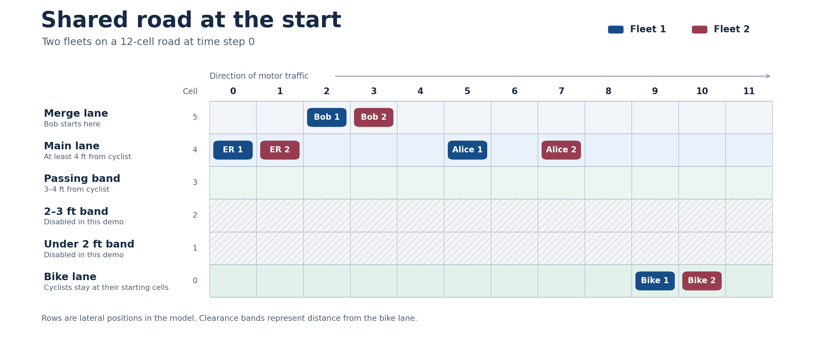

# icaps27
## About this demo

This is a small starting example for getting familiar with the road model and testing bargaining proposals. The setup can grow as needed. We can let the cyclists move, give vehicles more lane choices, enable additional passing-distance bands, lengthen the road, or give each episode more time steps. These changes can increase the number of road states and combinations of fleet actions the evaluator has to consider. Starting small makes it easier to see why the norm passes or fails before trying a larger scenario.

## Road scenario and rules

Two fleets share a road with 12 longitudinal cells. Each fleet has four road users: Alice (the lead car), Bob (the merging car), an emergency vehicle (ER), and a cyclist. Each fleet is one bargaining operator. At each of the time steps, its policy chooses actions for its four road users based on the shared road state.



| Rule | How the evaluator checks it |
|---|---|
| **Collision safety** | The probability of completing the episode without a vehicle collision or a cyclist collision must be 1. This applies within and across fleets. |
| **ER speed** | Each fleet’s ER has a speed limit of 2 cells per step. The evaluator checks the probability that each ER stays within that limit for the entire episode. The initial norm requires satisfaction of the speed limit with probability 1. |
| **Cyclist clearance** | The cyclists occupy a bike lane along the edge of the road. Under the initial rule, a vehicle from either fleet must leave at least 4 ft of space when passing a cyclist. During negotiation, either fleet can propose lowering that minimum to 3 ft or 2 ft. For example, a pass at 3.5 ft would fail the initial rule and pass under a 3 ft agreement. |

## What each road user can do and what it costs

All costs are in **model units**. Lower cost is better. A lane-use cost is charged to the vehicle choosing that lane. A close-pass cost is charged to the cyclist who experiences the encounter.

| Road user | Actions in this demo | Main costs |
|---|---|---|
| **Alice — lead car** | Moves 1 cell per step. In eligible states, she can choose the 4 ft lane or the 3–4 ft band. | `0.16` per active step, `+2.50` for choosing the 3–4 ft band, and `+8` if she has yet to reach the road end when the episode ends. The model also charges her `+4` when Bob tailgates her. |
| **Bob — merging car** | Moves 1 cell per step. The model moves him from the merge lane into the 4 ft lane when he reaches his merge point. | `2.43` per active step and `+32` if he has yet to merge when the episode ends. The model also charges him `+1.20` for tailgating Alice. |
| **ER — emergency vehicle** | Chooses speed 2 or 3. In eligible states, it can choose the center lane or the 3–4 ft band. | `4.54` per active step at speed 2 or `4.56` at speed 3, plus `0.05` for speeding at speed 3. Choosing the 3–4 ft band adds `0.20`. Ending the episode before reaching the road end adds `70`. |
| **Cyclist** | Stays at its starting cell along the road edge. | `0.05` per active step and `+2` for a vehicle encounter in the 3–4 ft band. The model also defines a closer-pass cost of `8` and a cyclist-collision cost of `500`. |

The model assigns collision penalties when scoring a policy pair, and the hard safety rule makes any pair with positive collision probability infeasible. The two-step horizon ends before either fleet’s Alice or ER can reach the road end and before either Bob can merge, so those terminal charges are fixed in this demo.

**Example.** Fleet 2’s Alice starts at cell 7. If she moves to cell 8 in the 3–4 ft band, she pays `2.50` for using that band, and Fleet 1’s cyclist at cell 9 incurs `2` for the encounter. That encounter violates the 4 ft clearance rule and satisfies the 3 ft definition. One fleet’s action can therefore affect the other fleet’s cost and whether the pair passes the proposed norm.

## Tailgating and road norms

**Tailgating** means that Bob ends a step **one cell behind Alice in the same lane**, while both are still driving. A gap of **two or more cells** is normal following distance for this check. The model charges Bob `1.20` for tailgating and Alice `4.00` for being tailgated. 

| Rule | Initial setting | What a proposal can change |
|---|---|---|
| **Collision safety** | There must be a **100% probability** of avoiding vehicle and cyclist collisions throughout the episode, including between fleets. | Fixed. Every proposal must satisfy this requirement. |
| **ER speed** | Each fleet’s ER must stay at or below **2 cells per step** for the whole episode with **100% probability**. | A new norm can lower the required probability. For example, a **50%** requirement means that at least half of the possible runs must have zero speeding by that ER. |
| **Cyclist clearance** | Each cyclist must receive at least **4 ft of clearance** on every modeled pass, with **100% probability**. | A new norm can lower the minimum clearance to **3 ft** or **2 ft**. The closest available passing band in this demo is **3–4 ft**, so both relaxed definitions allow the same passes here. |

The **initial negotiable norm** combines the 100% ER speed requirement and the 4 ft clearance rule. Collision safety is a hard requirement for every agreement.

## How fleet costs are calculated

Each fleet’s cost is a weighted sum of its four road users’ expected costs. The same road event can matter differently to the two operators because they use different weights.

| Operator | Alice | Bob | ER | Cyclist | Demo cost cap |
|---|---:|---:|---:|---:|---:|
| Fleet 1 | 0.10 | 0.10 | 0.60 | 0.20 | 60 |
| Fleet 2 | 0.10 | 0.10 | 0.30 | 0.50 | 35 |

## Model files

| File | What it does |
|---|---|
| `agent.py` | Defines the four road users, their state and actions, movement rules, event flags, and per-user cost coefficients in `E4CostParams`. Uses NumPy. |
| `bargaining_operator.py` | Places two fleets on the same road, adds interactions between them, and builds the joint model with fleet costs and norm checks. Uses the first module, NumPy, and SciPy. |

## How we express and evaluate a norm

An offer specifies the required probability of a speeding-free episode for each emergency vehicle (ER) and the minimum clearance for each cyclist. The initial norm is `road_norm(1.0, 4)`. It requires 100% ER speed compliance and 4 ft of cyclist clearance.

### 1. Write the norm in PCTL

The road model records speeding, passing, and collision events as the episode progresses. Let $T$ mean the episode has ended. Let $N_i$ mean Fleet $i$'s ER has never commanded a speed above 2 cells per step, and let $S_{i,d}$ mean Fleet $i$'s cyclist has satisfied the $d$-foot clearance definition throughout the episode. The cyclist check includes passes by vehicles from either fleet.

For a no-speeding probability threshold $\theta$ and a clearance definition $d$, the offered norm is

```math
\Phi_{\theta,d}
=
\bigwedge_{i=1}^{2}
\left(
\mathsf{P}_{\ge\theta}\big[\mathsf{F}(T\land N_i)\big]
\land
\mathsf{P}_{\ge 1}\big[\mathsf{F}(T\land S_{i,d})\big]
\right).
```

Here $\mathsf{F}$ means “eventually.” Since every episode ends by the horizon, the flags at the terminal state tell us whether the rules held throughout the episode. The initial norm is $\Phi_{1,4}$. Separate hard safety constraints require zero probability of vehicle and cyclist collisions.

### 2. Convert the probability checks into linear inequalities

Let $x(s,a)$ be the expected number of times the two fleets take joint action $a$ in state $s$ during one episode. The vector $x$ is the **occupation measure**.

For each monitored property $\psi$, the code builds a vector $q_\psi$. Its entry for $(s,a)$ is the probability that this action leads directly to a terminal state where $\psi$ holds.

```math
q_\psi(s,a)
=
\sum_{s'\models T\land\psi} P(s'\mid s,a).
```

Every episode enters a terminal state exactly once. We can therefore compute the probability of a compliant episode by adding the contributions of all transitions into compliant terminal states.

```math
\Pr\big[\mathsf{F}(T\land\psi)\big]
=
\sum_{s,a} q_\psi(s,a)\,x(s,a)
=
q_\psi^\top x.
```

For example, requiring Fleet $i$'s ER to obey the speed limit with probability at least $\theta$ gives the linear inequality $q_{N_i}^\top x\ge\theta$. The function `build_two_fleet_lp_data()` builds these probability vectors, the occupation flow constraints, and the fleet cost vectors.

### 3. Apply the offered threshold and clearance definition

`road_norm(theta, clearance_ft)` encodes an offer as $z=(\tau,\sigma_4,\sigma_3,\sigma_2)$. The speed relaxation is $\tau=1-\theta$. For example, $\tau=0.5$ requires a speeding-free episode with probability at least 0.5 for each ER.

The clearance definition changes which encounters count as violations. The three clearance slacks select the definition as follows.

| Offered clearance | What the monitor checks | Clearance slacks |
|---|---|---|
| **4 ft** | No encounters in the 3–4 ft band, closer passes, or cyclist collisions | $(0,0,0)$ |
| **3 ft** | No closer passes or cyclist collisions | $(1,0,0)$ |
| **2 ft** | No modeled cyclist collisions | $(1,1,0)$ |

Each candidate clearance row requires $q_{S_{i,d}}^\top x\ge 1-\sigma_d$. A slack of 1 lowers that row’s required probability to zero, leaving the chosen definition as the strictest active check. The 3 ft and 2 ft checks agree in the current demo because the closer passing bands are disabled.

The code stacks the speed and clearance inequalities for both fleets in the form

```math
G_{\mathrm{relax}}x+b_{\mathrm{relax}}\le Rz.
```

### 4. Solve or evaluate a proposal

For **O1**, the evaluator fixes Fleet 2’s policy and uses `scipy.optimize.linprog` to find the lowest-cost Fleet 1 policy that satisfies the flow constraints, hard safety rules, and offered norm. **O2** does the same with the fleets reversed. Each solve compares the minimum cost with the responding fleet’s cost cap.

When both fleets submit a policy, `evaluate_pair()` checks the probabilities and both cost caps for that exact pair under the offered norm.
